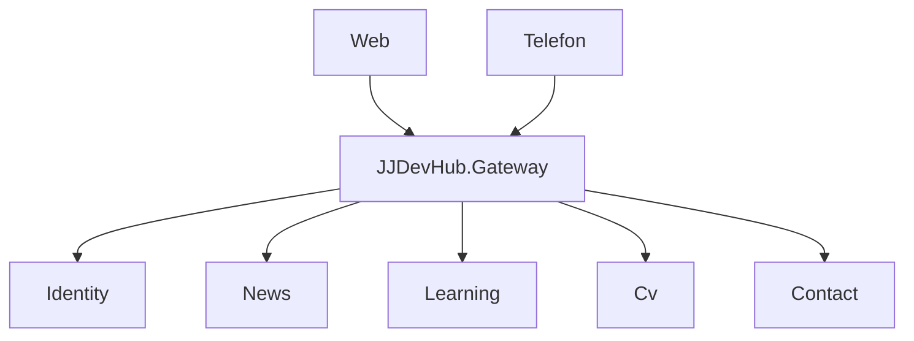
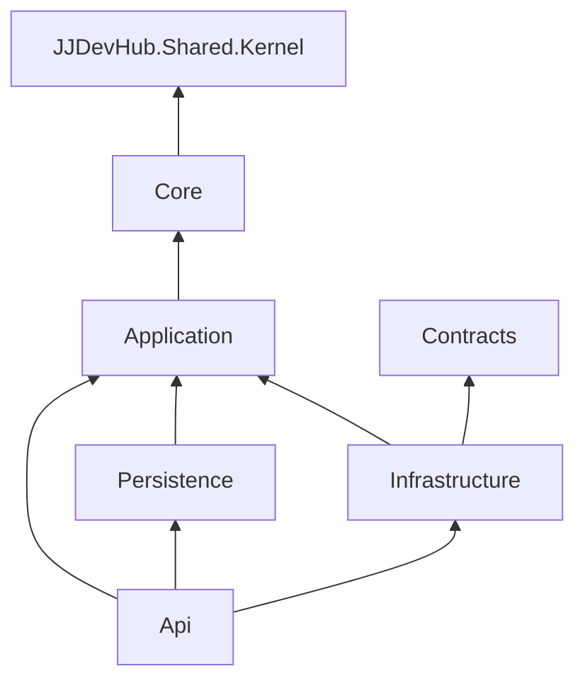
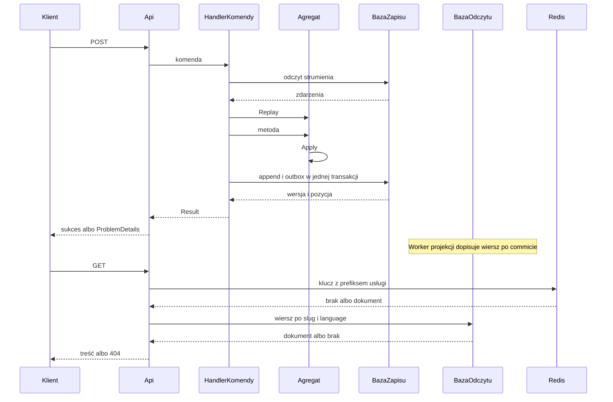
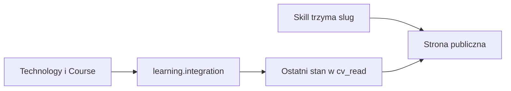
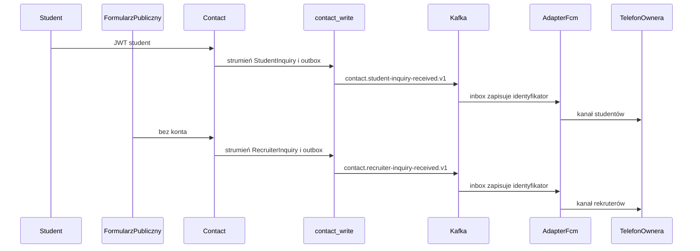

# Architektura

Ten plik jest mapą działającego systemu. Nie jest numerem i nie zawiera kroków wdrożenia.
Słownik nazw, licencje, ścieżki i kolejka `01`–`22` są w [README.md](README.md). Pierwszy kod
składu opisuje [01-aspire.md](01-aspire.md). Kto szuka kolejności prac, czyta kolejkę. Kto
szuka tego, jak żądanie przechodzi przez bramę, strumień, widok i szynę, czyta ten plik.

JJDevHub jest stroną CV i kompendium kursów. Właściciel, rola `owner`, edytuje treść.
Student czyta lekcje i pisze do właściciela. Rekruter czyta publiczne CV i wysyła osobne
zapytanie. Ta sama treść idzie do przeglądarki i na telefon. Pięć usług trzyma własne bazy.
Między usługami jedzie zdarzenie przez Kafkę. Sekret nie wchodzi do repozytorium.

Wzorem granic usług, osobnej bazy, outboxa, Aspire i bramy YARP jest
[eShop](https://github.com/dotnet/eshop). Brokerem w tym systemie jest Kafka w trybie KRaft,
bo ostatni stan technologii ma zostać w kompaktowanym temacie, a nie w kolejce, która gubi
historię klucza. Redis jest cachem od pierwszego numeru składu. Nazwa zasobu to `cache`.
Cache nie jest magazynem strumienia i nie jest modelem odczytu.

## Granice usług

Brama nie ma domeny. Usługa nie otwiera bazy sąsiada i nie referencjonuje projektu `Core`,
`Persistence` ani `Api` sąsiada. Wolno jej referencjonować cudze `Contracts`, gdy konsumuje
zdarzenie integracyjne. Granica jest connection stringiem i referencją projektu, nie umową
w komentarzu. Gdyby News dostało ciąg do `learning_read`, reguła notatki zaczęłaby zależeć
od katalogu, który może być w trakcie projekcji albo w ogóle wyłączony.

Przeglądarka i telefon znają jeden adres. Nie znają hostów pięciu procesów i nie trzymają
pięciu certyfikatów. Brama przyjmuje żądanie, sprawdza podpis tokenu, gdy token jest, i
przekazuje je do usługi. Szyna nie przechodzi przez bramę. Cloudflare kończy tunel na YARP.
Pięć usług nie ma własnego wejścia z zewnątrz.

| Usługa | Agregaty i stan | Kto pisze | Kto czyta |
| --- | --- | --- | --- |
| Identity | `Account`, `Invite`, role `owner` i `student` | właściciel i rejestracja studenta | każda usługa sprawdza JWT |
| News | `Article` | `owner` | publicznie albo według widoczności |
| Learning | `Category`, `Technology`, `Course`, `Lesson`; `StudentProgress` jako zwykły stan | `owner`, postęp zapisuje student | publicznie, studenci, właściciel |
| Cv | `Profile`, `Position`, `Project`, `Education`, `Activity`, `Skill`, `Language` | `owner` | publiczny odczyt |
| Contact | `StudentInquiry`, `RecruiterInquiry` | student albo formularz publiczny | `owner` |

Klasa nie nazywa się jak segment namespace. W News jest `Article`. W Cv nie ma klasy `Cv`.
W Contact nie ma klasy `Contact`. Agregat jest granicą spójności jednej historii, nie nazwą
usługi. Kompilator i tak pomyliłby typ `News` z przestrzenią `JJDevHub.News`. Dwa zapytania
Contact są dwoma agregatami, bo mają inne uprawnienie i inny kanał na telefonie właściciela.

Event sourcing jest tam, gdzie historia jest produktem. Strumień mają: artykuł, konto,
zaproszenie, technologia, kurs, lekcja, każda sekcja CV, oba zapytania. `StudentProgress`
jest wierszem stanu, bo postęp studenta nie jest dziennikiem do odtworzenia na stronie
publicznej. Blok kodu wewnątrz lekcji jest fragmentem Markdown tej lekcji i też nie ma
strumienia. Kategoria katalogu jest półką na technologie, nie materiałem ze historią brzmień.

`JJDevHub.Shared.Kernel` nie zna tych nazw domenowych. Nie ma w nim typu `Article`,
`Account`, `Lesson`, `Profile` ani `StudentInquiry`. Jądro zna `Result<T>`, kody, `Entity`,
`ValueObject`, `TimeProvider`, kontrakt zdarzenia i mechanikę agregatu. Dzięki temu test
domeny News nie ciągnie konta, a zmiana reguły `Article` nie zmienia `Skill`.

Gateway YARP sprawdza podpis JWT kluczem publicznym Identity i wystawia `GET /versions`.
Nie składa strony CV i nie czyta żadnej z dziesięciu baz. Cloudflare kończy tunel na tej
bramie. YARP jest jedyną bramą HTTP aplikacji. Klucz prywatny zostaje w Identity. Wyciek
konfiguracji bramy nie podpisuje tokenu.

Link między usługami jest slugiem. Identyfikator wiersza z cudzej bazy nie wchodzi do
zdarzenia integracyjnego ani do treści. Slug technologii nie zmienia się po publikacji.
Zmiana nazwy wyświetlanej nie zmienia adresu. Gdy cel zniknie, slug zostaje faktem
historycznym, a widok pokazuje brak celu. News może wskazać lekcję tym samym sposobem:
wskaźnik zostaje w News, a Learning nie jest odpytywane przy renderze notatki.

## Warstwy

Każda usługa z domeną ma sześć projektów. Strzałka na diagramie oznacza kierunek referencji:
projekt u góry zależy od projektu u dołu. `Core` zostaje na dole razem z jądrem, bo reguła
nie może zależeć od hosta HTTP, od Entity Framework ani od Kafki.

| Projekt | Zna | Nie zna |
| --- | --- | --- |
| `Core` | jądro | MediatR, EF, Kafka, ASP.NET, Mongo, Redis |
| `Application` | `Core`, porty, własny mediator | konkretnej bazy i brokera |
| `Api` | skład hosta w `Program.cs` | reguł domeny wpisanych w endpoint |
| `Persistence` | porty zapisu i odczytu | cudzej bazy |
| `Infrastructure` | cache, szynę, sekrety, push | agregatu sąsiada |
| `Contracts` | rekordy zdarzeń integracyjnych | handlerów |

`Api` jest jedynym miejscem, które wiąże port z implementacją. Handler w `Application`
dostaje `IEventStore` albo port odczytu, nie `NpgsqlDataSource` sąsiada. Test jednostkowy
`Core` nie podnosi kontenera. Endpoint, który sam otwiera transakcję, sam sprawdza tytuł i
sam pisze SQL, miesza przypadek użycia z regułą. Drugi endpoint skopiuje te linie albo je
zgubi.

Własny mediator siedzi w `src/shared/JJDevHub.Cqrs`. Magazyn zdarzeń siedzi w
`src/shared/JJDevHub.EventStore` i `src/shared/JJDevHub.EventStore.Postgres`. Outbox siedzi
w `src/shared/JJDevHub.EventBus` oraz `src/shared/JJDevHub.IntegrationEventLog`. Adapter
Kafki siedzi w `src/shared/JJDevHub.EventBus.Kafka`. Te projekty nie znają `Article` ani
`Skill`. MediatR i gotowy outbox z eShop nie wchodzą: mechanizm jest treścią numerów, a
licencja MediatR od linii 13 nie jest wolna produkcyjnie. Mapowanie między zdarzeniem
domenowym a rekordem `Contracts` jest ręczne. AutoMapper nie wchodzi z tego samego powodu
licencyjnego.

`Contracts` wolno referencjonować z innej usługi. Reszty sąsiada nie wolno. Cv może znać
kształt rekordu z `Learning.Contracts`, bo czyta temat `learning.integration`. Cv nie może
znać agregatu `Technology` ani otworzyć `learning_write`.

## Zapis i odczyt

Jeden proces PostgreSQL. Dziesięć baz: `identity_write`, `identity_read`, `news_write`,
`news_read`, `learning_write`, `learning_read`, `cv_write`, `cv_read`, `contact_write`,
`contact_read`. Zapis i odczyt są osobnymi bazami, nie dwoma schematami jednego connection
stringa. Dwa schematy przegrałyby z osobną bazą, bo ten sam ciąg połączenia nadal sięga obu
schematów. Osobny serwer na usługę też odpada: strumień i outbox mają jeden commit, a pięć
silników nic tu nie upraszcza.

Handler komendy nie otwiera `*_read`. Handler zapytania nie woła `IEventStore`. Odtwarzanie
strumienia na ścieżce `GET` nie występuje, bo lista notatek i strona CV są zapytaniem pod
indeks, nie złożeniem historii. Projekcja jest asynchroniczna. Zaraz po `POST` odczyt może
jeszcze nie widzieć wiersza i zwraca `404`. Klient ponawia odczyt. To jest stan przejściowy,
nie błąd komendy. Zapis nie czeka na indeksy odczytu. Błąd widoku nie wycofuje faktu, który
już zaszedł.

Model odczytu jest wierszem albo dokumentem JSONB. Kolumny `slug`, `category` i `language`
mają indeks btree. Zapytanie listy kategorii i zapytanie jednej notatki po slugu korzystają
z tych indeksów. `Article`, `Lesson` i strona CV różnią się kształtem JSONB. Nie różnią się
tym, że da się je znaleźć po slugu, kategorii i języku. MongoDB i OpenSearch nie są modelem
odczytu.

Redis trzyma gorącą kopię publicznej strony CV i katalogu kursów. Klucz ma postać
`<usługa>:<zasób>:<slug>:<język>`, na przykład `cv:page:jakub:pl`. Utrata Redisa spowalnia
odczyt. Dane zostają w PostgreSQL. Limit zapytań i krótkie blokady też idą przez Redis i
też giną razem z procesem cache bez utraty strumienia. Prefiks jest nazwą usługi, więc klucz
News nie wchodzi w przestrzeń Cv.

Outbox leży w bazie zapisu, w tej samej transakcji co dopisanie zdarzeń. Publikacja na Kafkę
jest poza tą transakcją. Jeśli proces padnie po commicie, a przed publikacją, kolejny obieg
outboxa wysyła ten sam rekord. Inbox konsumenta pamięta identyfikator wiadomości. Drugi pod
nie stosuje faktu drugi raz i nie wysyła drugiego pusha. To jest odbiór idempotentny: druga
dostawa nie ma drugiego skutku. Dzięki wspólnemu commitowi nie ma zdarzenia na szynie bez
zdarzenia w strumieniu.

Oczekiwany wynik komendy to `Result<T>`. Pusty tytuł, brak wiersza projekcji, konflikt
wersji i brak roli są rodzajami `Invalid`, `NotFound`, `Conflict` i `Forbidden`. Wyjątek
zostaje, gdy pęknie IO albo skład hosta. Brzeg `Api` zamienia oba przypadki na
`ProblemDetails`. Język bierze z `Accept-Language`. Na start są kultury `pl` i `en`. Pole
`type` zostaje kodem, pole `title` jest przetłumaczone. Jądro nie trzyma zdań.

Zapis ze znacznikiem `ETag` wymaga `If-Match`. Brak nagłówka to `428`. Nieaktualny znacznik
to `412`. Treść niewidoczna dla czytelnika, szkic notatki dla anonima albo lekcja poza grupą,
kończy się `404`. Osobny status nie zdradza, że wiersz istnieje. Te kody ustawia brzeg, nie
`Core`.

Globalna pozycja w magazynie jest kursorem projekcji. Wersja strumienia jest kursorem
optymistycznej współbieżności jednego agregatu. To są dwa liczniki. Pozycja rośnie przez
wszystkie strumienie usługi. Wersja rośnie tylko w swoim strumieniu. Konflikt wersji zwraca
`Result` z rodzajem `Conflict` i kodem `stream.version.conflict`.

## Od Learning do CV

Umiejętność na stronie CV jest śladem technologii z katalogu. Ślad jest slugiem, nie kluczem
obcym do `learning_read`. Cv nie woła Learning po HTTP, żeby złożyć stronę. Gdyby wołało,
publiczny odczyt CV zależałby od dostępności katalogu i od kształtu cudzej bazy. Strona ma
dać się narysować z jednego odczytu.

`Technology` i `Course` są strumieniami w `learning_write`. Po zmianie Learning publikuje
rekord z `Learning.Contracts` na temat `learning.integration`. Temat jest kompaktowany.
Zostaje ostatni stan sluga, nie cała historia pośrednich nazw. Konsument w Cv zapisuje tę
kopię w `cv_read`. `Skill` w `cv_write` trzyma ten sam slug. Strona publiczna czyta wyłącznie
`cv_read`: sekcje CV plus kopię nazwy technologii.

Gdy technologia zniknie z katalogu, kompaktowany temat niesie stan usunięcia albo przestaje
mieć klucz. Kopia w `cv_read` pokazuje brak celu. Slug w `Skill` zostaje, bo był prawdziwy w
dniu publikacji CV. Widok nie udaje, że technologia nadal jest w katalogu. Starsza wersja
stanu nie cofa kopii, którą konsument już zapisał z wyższą wersją.

`StudentProgress` nie jedzie tym tematem. Postęp jest prywatnym stanem studenta w Learning.
Publiczne CV właściciela nie jest dziennikiem postępu studentów. News może wskazać lekcję
slugiem na tej samej zasadzie: wskaźnik zostaje w News, a Learning nie jest odpytywane przy
renderze notatki.

Projekt w CV też może podać slug technologii. To nadal pole w `Project`, nie zapytanie do
`learning_read`. Jeden slug da się pokazać przy umiejętności i przy projekcie, bo oba czytają
kopię z `cv_read`. Zmiana nazwy wyświetlanej w katalogu nie przepisuje strumienia `Skill`.
Adres zostaje. Zmienia się tylko kopia nazwy, którą strona doczyta przy następnym stanie
tematu.

## Dwa kanały Contact

Są dwa agregaty i dwa fakty na szynie. Formularz publiczny zawsze tworzy `RecruiterInquiry`.
`StudentInquiry` powstaje tylko z tokenem roli `student`. Token roli `owner` na tym
endpoincie nie tworzy zapytania studenta. Jeden agregat `Contact` zgubiłby to rozróżnienie
i wpuściłby właściciela na ścieżkę, która ma być skrzynką od studentów.

Oba fakty wychodzą z `contact_write` przez outbox. Konsument jest w Contact, nie w osobnej
usłudze powiadomień. Adapter woła FCM HTTP v1. Ta sama ścieżka obsługuje dostarczenie na
APNs. Klucz konta usługi leży w OpenBao i jest czytany przez `ISecretReader`. W
repozytorium nie ma tego klucza. Brak OpenBao w chwili pusha jest awarią IO: wyjątek,
ponowienie, brak cichego przejścia na pusty klucz.

Telefon rejestruje token urządzenia w Contact na czas zalogowania roli `owner`. Wylogowanie
kasuje token. Bez tokenu konsument zapisuje inbox i nie ma adresata pusha. Dwa kanały mają
inny tytuł i otwierają inną skrzynkę: studenci albo rekruterzy. Owner czyta dwie listy z
`contact_read`. Student nie czyta listy rekruterów. Rekruter nie ma konta i nie czyta żadnej
listy.

Idempotencja jest po identyfikatorze wiadomości w inboxie. Drugi pod Contact, podniesiony
przy obciążeniu, widzi ten sam fakt i nie wysyła powiadomienia drugi raz. Zdarzenie
domenowe zostaje w strumieniu. Na szynę wychodzą dwa rekordy:
`contact.student-inquiry-received.v1` i `contact.recruiter-inquiry-received.v1`. Jeden temat
integracyjny usługi, dwa fakty, dwa kanały.

## Szyna

Kafka działa w trybie KRaft. W AppHost i na maszynie jest jeden broker. Nazwa zdarzenia jest
stabilna. Przykład z News: `news.article-created.v1`. Nazwa typu CLR, na przykład
`ArticleCreatedDomainEvent`, nie jest kluczem. Konsument w innym języku czyta ten sam
łańcuch, bez znajomości zestawu .NET.

Temat należy do jednej usługi. Konsument innej usługi czyta temat, którego nie tworzy.
`learning.integration` jest kompaktowany, więc Cv odtwarza ostatni stan bez czytania
`learning_write`. `contact.integration` niesie dwa różne fakty. RabbitMQ odpadło, bo nie
daje kompaktowanego tematu pod ostatni stan technologii. Drugi broker i replikacja większa
niż jeden nie są celem tej maszyny.

Zdarzenie domenowe nie opuszcza usługi. `IDomainEvent` żyje w procesie i w strumieniu bazy
zapisu. Na szynę wychodzi osobny rekord z `Contracts`, złożony przez mapowanie w
`Application`. Mapowanie jest ręczne. AutoMapper nie wchodzi. Gdyby na szynę wyszedł rekord
domenowy, konsument Cv znałby kształt wewnętrzny Learning i psułby się przy każdym
refaktorze agregatu.

Dopisanie do strumienia i wiersz outboxa commitują się razem. Sam publish jest później.
Dzięki temu nie ma zdarzenia na szynie bez zdarzenia w historii. Konflikt wersji strumienia
zwraca `Result` z rodzajem `Conflict` i kodem `stream.version.conflict`. Komenda nie rzuca
wyjątku tylko dlatego, że ktoś zapisał ten sam strumień chwilę wcześniej.

Offset konsumenta nie schodzi, zanim odbiór nie skończy się obsłużeniem, duplikatem albo
świadomym zignorowaniem. Piąta porażka ląduje na kolejce martwych listów tej grupy. Wciąganie
wiadomości z powrotem na temat jest ręczne, tym samym identyfikatorem zdarzenia, żeby inbox
nadal widział duplikat.

## Sekrety, cache i skład

OpenBao na licencji MPL-2.0 trzyma sekrety. HashiCorp Vault odpada przez licencję BSL.
Keycloak odpada, bo konta i role są usługą Identity, a sekrety nie są użytkownikami.
Lokalnie AppHost stawia OpenBao w trybie deweloperskim. Token tego trybu jest w user
secrets. `appsettings.json` nie zawiera wartości sekretu. Na maszynie klucz rozszczelnienia
jest w vTPM, a usługa dostaje krótkotrwałe poświadczenie bazy. Ten plik nie opisuje kroków
stawiania maszyny.

Każdy odczyt sekretu przechodzi przez `ISecretReader`. Adapter HTTP do KV v2 siedzi poza
jądrem. Port zwraca `Result`: brak ścieżki to `secret.path.missing` i rodzaj `NotFound`,
odmowa polityki to `secret.path.forbidden` i rodzaj `Forbidden`. Wartość nie wchodzi do logu.
Kontener deweloperski nie jest opisem składu maszyny.

Redis nazywa się `cache` już w składzie Aspire. Prefiks klucza jest nazwą usługi, więc
`news` nie nadpisuje klucza `cv`. Cache nie jest magazynem strumienia i nie jest modelem
odczytu. Po restarcie Redisa projekcja w PostgreSQL nadal odpowiada na `GET`. Awaria cache
na odczycie nie kończy się `503` tylko z tego powodu. Zapytanie schodzi do bazy odczytu.
Awaria cache po commicie projekcji nie cofa wiersza.

`JJDevHub.AppHost` jest korzeniem składu lokalnego. `JJDevHub.ServiceDefaults` dokłada
health, odkrywanie usług i haki OpenTelemetry każdej usłudze HTTP. Dashboard Aspire zbiera
logi, ślady i metryki w developmentcie. AppHost nie jedzie na produkcję. Na maszynie obrazy
usług stoją na k3s, a telemetria idzie do kolektora na tej maszynie. Publiczna chmura nie
jest celem runtime. Eksporter OTLP włącza się tylko wtedy, gdy jest niepusty endpoint.
Adres kolektora nie jest wpisany w `appsettings.json`, bo w developmentcie i na maszynie jest
inny.

`/health` wymaga wszystkich sprawdzeń. `/alive` wymaga sprawdzeń z tagiem `live`. Domyślne
sprawdzenie nazywa się `self` i mówi, że proces odpowiada. Nie mówi, że Redis przyjął zapis
ani że PostgreSQL ma tabele. Oba endpointy są mapowane także poza środowiskiem Development.
Odpowiedź nie zawiera connection stringa ani ciała wyjątku.

## Spójność, której pilnują numery

| Reguła | Skutek złamania |
| --- | --- |
| Usługa ma tylko swoje dwie bazy | wyciek odczytu albo zapisu sąsiada |
| Komenda nie widzi bazy odczytu | reguła domeny zaczyna zależeć od projekcji, która może być w tyle |
| Zapytanie nie widzi strumienia | `GET` odtwarza historię i omija indeks |
| Pole agregatu zmienia się w `Apply` | `Replay` buduje inny stan niż komenda |
| Nazwa zdarzenia pochodzi z atrybutu | wdrożenie zmienia kontrakt przy zmianie nazwy klasy |
| Outbox w transakcji strumienia | szyna ma fakt, którego nie ma w historii |
| Sekret tylko z `ISecretReader` | wartość ląduje w pliku albo w logu |
| `Result` dla błędu oczekiwanego | klient dostaje 500 zamiast kodu `article.title.blank` |

Pole agregatu zmienia się w `Apply`, nie w metodzie, która przyjmuje komendę. Inaczej
`Replay` złoży inny stan niż ten, który komenda właśnie zatwierdziła, i strumień przestanie
być źródłem prawdy. Metoda publiczna sprawdza regułę, buduje zdarzenie i woła `Apply`.
Odtworzenie stosuje te same `Apply` i nie dopisuje nowych faktów.

Wersja komponentu jest osobna: `identity`, `news`, `learning`, `cv`, `contact`, `gateway`,
`web`, `mobile`. Zmiana w `JJDevHub.Shared.Kernel` podbija każdą usługę, która go
referencjonuje. Tag jednej usługi nie przebudowuje pozostałych obrazów. `GET /versions`
pokazuje numery działających usług obok numeru klienta. Pole usługi, która nie odpowiedziała,
zostaje puste, a brama i tak zwraca swój numer. Stopka klienta porównuje te numery z numerem
własnego bundla.

## Gdzie czytać dalej

Przepływ z tego pliku nie mówi, w jakiej kolejności powstaje kod. Kolejka jest w
[README.md](README.md). Skład lokalny zaczyna się w [01-aspire.md](01-aspire.md). Bazy zapisu
są w [02-postgres.md](02-postgres.md), bazy odczytu w [03-odczyt.md](03-odczyt.md). Sekret
jest w [04-openbao.md](04-openbao.md). Typy jądra są w [05-kernel.md](05-kernel.md),
[06-zdarzenie.md](06-zdarzenie.md) i [07-agregat.md](07-agregat.md). Port strumienia w
pamięci jest w [08-strumien.md](08-strumien.md).

Ten sam port na PostgreSQL jest w [09-persistence.md](09-persistence.md). Mediator jest w
[10-cqrs.md](10-cqrs.md). Język błędu jest w [11-walidacja.md](11-walidacja.md). Worker
widoku jest w [12-projekcja.md](12-projekcja.md). Cache jest w [13-redis.md](13-redis.md).
Outbox i inbox są w [14-outbox.md](14-outbox.md). Kafka jest w [15-kafka.md](15-kafka.md).
Brama jest w [16-gateway.md](16-gateway.md). Pięć usług zamyka się od
[17-identity.md](17-identity.md) do [21-kontakt.md](21-kontakt.md). Piramida testów domyka
się w [22-testy.md](22-testy.md).

## Źródła

- Eric Evans, *Domain-Driven Design*. Agregat jest granicą spójności, a język w kodzie jest
  językiem produktu. Stąd osobne historie `Article`, `Skill` i `StudentInquiry` oraz zakaz
  klasy o nazwie segmentu namespace. Nie bierzemy stąd jednego modelu dziedzinowego na pięć
  usług. Jądro zostaje mechaniką, bez nazw domenowych.
- Vaughn Vernon, *Implementing Domain-Driven Design*. Zdarzenie domenowe jest faktem, który
  już zaszedł, i zostaje wewnątrz granicy usługi. Na szynę wychodzi osobny rekord z
  `Contracts`. Nie bierzemy stąd publikowania agregatu na magistralę ani współdzielonej
  biblioteki modelu między News a Cv.
- [eShop](https://github.com/dotnet/eshop). Wzór granic usług, osobnej bazy, Aspire,
  `ServiceDefaults`, outboxa i bramy YARP. Układ sześciu projektów usługi jest z tej samej
  rodziny. Nie bierzemy MediatR, AutoMappera ani gotowej paczki dziennika integracyjnego.
  Te trzy mechanizmy są kodem tego repozytorium.
- [Database per service](https://microservices.io/patterns/data/database-per-service.html).
  Chris Richardson: usługa nie sięga do tabel sąsiada. U nas znaczy to dwie bazy na usługę,
  zapis i odczyt, na jednym PostgreSQL. Nie bierzemy stąd osobnego serwera na każdą bazę.
  Wspólny commit strumienia i outboxa wymaga tego samego silnika.
- [CQRS](https://learn.microsoft.com/azure/architecture/patterns/cqrs). Osobny model zapisu
  i odczytu oraz spójność ostateczna widoku. `POST` wraca, zanim worker dogoni pozycję, i
  natychmiastowy `GET` może dostać `404`. Nie bierzemy stąd odtwarzania strumienia na
  ścieżce odczytu ani drugiego silnika pod dokument.
- [Transactional outbox](https://microservices.io/patterns/data/transactional-outbox.html).
  Jeden commit z danymi domeny, osobna wysyłka na brokera. Strumień i wiersz outboxa
  zatwierdzają się razem. Publish jest później. Nie bierzemy stąd rozproszonego commitu
  między PostgreSQL a Kafką.
- [Idempotent Receiver](https://www.enterpriseintegrationpatterns.com/patterns/messaging/IdempotentReceiver.html).
  Gregor Hohpe i Bobby Woolf: druga dostawa nie ma drugiego skutku. Inbox pamięta
  identyfikator wiadomości, więc drugi pod Contact nie wysyła drugiego pusha. Nie bierzemy
  stąd „dokładnie raz” jako obietnicy brokera. Kafka dowozi co najmniej raz, a skutek pilnuje
  inbox.
- Martin Kleppmann, *Designing Data-Intensive Applications*. Log jest źródłem prawdy, a
  kompaktowanie zostawia ostatnią wartość klucza. Stąd temat `learning.integration` i kopia
  stanu w `cv_read`, bez czytania `learning_write`. Nie bierzemy stąd osobnego dziennika
  poza PostgreSQL dla strumienia usługi. Strumień i outbox mają wspólny commit.
- [Log compaction](https://kafka.apache.org/documentation/#compaction). Ostatnia wartość
  klucza zostaje, historia pośrednich nazw technologii odpada. Cv po restarcie czyta pełny
  stan sluga. Nie bierzemy stąd kompaktowania tematów, które niosą jednorazowy fakt, taki
  jak przyjęcie zapytania. Tam liczy się każda dostawa i inbox.
- [JSON Web Key (JWK)](https://www.rfc-editor.org/rfc/rfc7517). Dokument kluczy publicznych,
  z którego brama i usługi biorą materiał do sprawdzenia podpisu. Klucza prywatnego w tym
  dokumencie nie ma. Nie bierzemy stąd współdzielonego sekretu HMAC. Każdy pod, który
  sprawdza podpis, dostałby wtedy materiał zdolny ten podpis złożyć.
- [Event Sourcing](https://martinfowler.com/eaaDev/EventSourcing.html). Martin Fowler: stan
  jest wynikiem zdarzeń, odtworzenie nie dopisuje nowych. `Replay` woła `Apply`. Metoda
  komendy nie zapisuje pól z boku. Nie bierzemy stąd osobnego produktu magazynu zdarzeń.
  Port `IEventStore` siada na PostgreSQL tej samej usługi.
